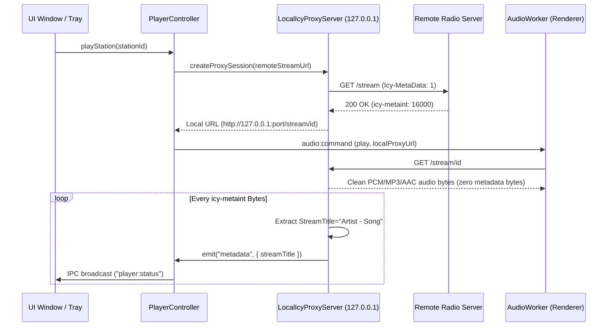

# Architecture & Technical Specifications

This document details the architectural design, component boundaries, protocols, and data models of **Squelch**, an open-source, resilient menu bar internet radio player built for macOS, Windows, and Linux.

---

<a id="arsitektur--spesifikasi-teknis"></a>
<a id="architecture--technical-specifications"></a>

## 1. Architectural Principles

Squelch enforces a strict, multi-tiered separation of concerns to guarantee long-term maintainability, platform portability, and memory safety:

```text
┌─────────────────────────────────────────────────────────────┐
│                    UI Presentation Layer                     │
│   React 18 · Tailwind CSS · Heroicons · macOS Vibrancy HUD   │
│   (Tray Popover · Main Management Window · About Window)    │
└──────────────────────────────┬──────────────────────────────┘
                               │ Typed IPC Bridges (ContextIsolation)
┌──────────────────────────────▼──────────────────────────────┐
│                  Electron Main Application                  │
│       WindowManager · Tray Coordinator · App Lifecycle       │
└──────────────────────────────┬──────────────────────────────┘
                               │
       ┌───────────────────────┴───────────────────────┐
       ▼                                               ▼
┌─────────────────────────────┐         ┌─────────────────────────────┐
│    Platform Adapter Layer   │         │     Core Domain Layer       │
│  (ITrayAdapter, ISystem)    │         │  (100% OS & DOM Independent)│
│  macOS / Windows / Linux    │         │  State Machines · Storage   │
└─────────────────────────────┘         │  Schedules · ICY Proxy · RB │
                                        └──────────────┬──────────────┘
                                                       │
                                        ┌──────────────▼──────────────┐
                                        │   Headless Audio Worker     │
                                        │   HTML5 Audio + hls.js      │
                                        └─────────────────────────────┘
```

1. **Zero Domain Pollution**: The domain layer (`src/core/`) must never import Electron, Node.js GUI APIs, or DOM globals.
2. **Crash-Resistant Storage**: All disk mutations use atomic rename transactions (`.tmp` → `fsync` → `rename`).
3. **Decoupled Audio Transport**: Audio rendering is sandboxed inside a headless background worker (`audio-worker/`) to isolate playback from UI thread stalls.
4. **Local StreamTitle Demuxing**: ICY metadata extraction runs through an in-process local loopback proxy (`127.0.0.1`), ensuring zero metadata stutter or protocol incompatibilities with browsers.

---

## 2. Audio Engine & ICY Proxy Architecture

Web browsers and Electron renderer processes natively support HTTP audio streams, but standard HTML5 `<audio>` cannot parse Shoutcast/Icecast in-band `StreamTitle` metadata without corrupting playback. Squelch solves this with an in-process loopback ICY demuxing server.

### Stream Lifecycle Flow



### Supported Codecs & Formats

| Format / Codec                            | Transport          | Decoder                  | Notes                          |
| :---------------------------------------- | :----------------- | :----------------------- | :----------------------------- |
| **MP3** (`audio/mpeg`)                    | HTTP / HTTPS / ICY | Native Web Audio / HTML5 | Full ICY metadata extraction   |
| **AAC / HE-AAC** (`audio/aac`)            | HTTP / HTTPS / ICY | Native Web Audio / HTML5 | ADTS & LATM/LOAS streams       |
| **OGG / Opus** (`audio/ogg`)              | HTTP / HTTPS       | Native Web Audio / HTML5 | Ogg Vorbis & Opus streams      |
| **HLS** (`application/vnd.apple.mpegurl`) | HTTP / HTTPS       | `hls.js` v1.5 Engine     | Multi-bitrate manifest parsing |

---

## 3. Show Schedules & Autoplay Background Engine

The schedule subsystem (`src/core/schedules/`) enables users to register recurring weekly radio programs with automated native OS desktop alerts and automatic tuning (_autoplay_).

### Data Specification (`ShowSchedule`)

```typescript
export interface ShowSchedule {
    id: string; // Unique UUID or seed identifier
    stationId: string; // Reference to user's saved Station
    stationName: string; // Cached station display name
    showName: string; // Name of the broadcast (e.g. "Sarapan Seru")
    host?: string; // Optional host / DJ names
    daysOfWeek: number[]; // 0=Sun, 1=Mon, ..., 5=Fri, 6=Sat
    startTime: string; // "HH:mm" in 24h format (e.g. "06:00")
    endTime: string; // "HH:mm" in 24h format (e.g. "10:00")
    autoPlay: boolean; // Trigger automatic station playback on start
    reminderMinutes: number; // 0 = At start, 5 = 5m before, 10 = 10m before
    enabled: boolean; // Master toggle switch
    notes?: string; // User notes or program synopsis
    createdAt: string; // ISO 8601 timestamp
    updatedAt: string; // ISO 8601 timestamp
}
```

### Execution Loop & Deduplication

- **Polling Frequency**: A dedicated background timer checks registered schedules every **20 seconds**.
- **Deduplication Matrix**: Prevents duplicate triggers within the active minute using composite daily keys:
    - `${schedule.id}_${YYYY-MM-DD}_remind` for advance alert triggers.
    - `${schedule.id}_${YYYY-MM-DD}_start` for on-air alerts and autoplay tuning.
- **Autoplay Action**: Dispatches directly to `PlayerController.play(station)` without interrupting existing audio if the station is already actively streaming.

---

## 4. Crash-Resilient Atomic Storage

All application state is stored locally without external database daemons using the `AtomicJsonStore<T>` architecture.

```text
[Memory Data]
      │
      ▼
1. Write JSON payload to:  <file>.json.tmp.<uuid>
      │
      ▼
2. Flush OS write buffers: fs.fsyncSync(fd)
      │
      ▼
3. Atomic OS swap:         fs.renameSync(tmpPath, targetPath)
      │
      ▼
[Permanent Disk Storage]
```

### Managed State Files

| File             | Schema Version | Content                                                   |
| :--------------- | :------------- | :-------------------------------------------------------- |
| `stations.json`  | `1`            | User stations list, categories, and favorites             |
| `schedules.json` | `1`            | Configured broadcast programs and autoplay flags          |
| `settings.json`  | `1`            | Theme, accent color, font family, shortcuts, and language |
| `stats.json`     | `1`            | Weekly, monthly, and yearly listening durations           |
| `state.json`     | `1`            | Runtime session state (last active station ID)            |

---

## 5. Platform Abstraction Layer

Squelch abstracts operating-system-specific integrations behind strict TypeScript contracts:

- `ITrayAdapter`:
    - `createTray(options)`: Handles platform status icon rendering, right-click context menus, and click handlers.
    - `updateStatus(state)`: Updates tray icon state (`playing`, `buffering`, `error`, `idle`).
- `ISystemIntegrationAdapter`:
    - `getAppDataPath()`: Resolves `%APPDATA%`, `~/Library/Application Support/`, or `~/.config/`.
    - `showNotification(title, body)`: Triggers native OS notifications.
    - `bindPowerEvents(callbacks)`: Listens for system sleep/wake and power state transitions.
    - `registerGlobalShortcuts(shortcuts, handlers)`: Binds global media keys and user-defined accelerator combos.

### macOS Signed Distance Field (SDF) Waveform Engine

The menu bar icon does not rely on static icon assets or heavy GIF decoders. It uses a custom **5-bar Signed Distance Field capsule generator** (`src/platform/macos/tray-icon-generator.ts`):

- Generates crisp 12-frame animated icon sets in-memory during bootstrap.
- Emits `@1x` (`18x18`) and `@2x` (`36x36`) Retina PNG buffers with `tray.setImage()` updates.
- Maintains `0%` CPU usage and zero memory leaks during indefinite continuous playback.

---

## 6. Security & Process Sandboxing

1. **Context Isolation**: `contextIsolation: true` and `nodeIntegration: false` on all renderer windows.
2. **Restricted Navigation**: `will-navigate` and `setWindowOpenHandler` intercept all external link clicks and forward them strictly to the system's default browser via `shell.openExternal()`.
3. **Hardened Preload Scripts**: Preload bridges expose only whitelisted, strictly-typed async methods. Direct IPC emitter access is prohibited.
