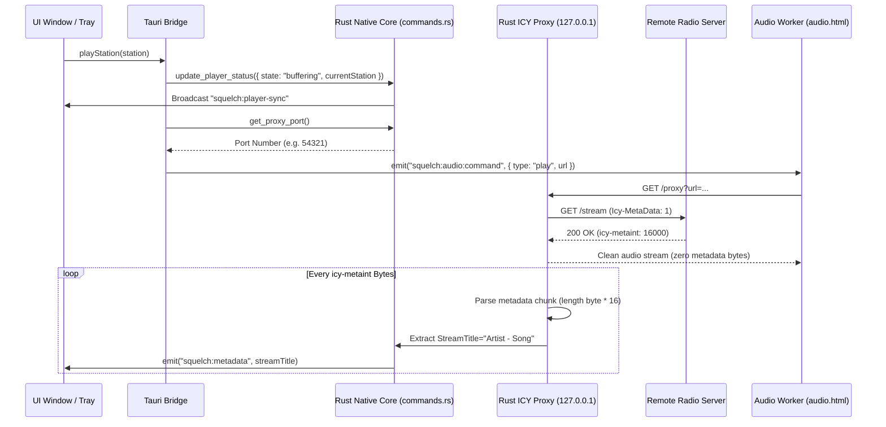

# Architecture & Technical Specifications

This document details the architectural design, component boundaries, protocols, and data models of **Squelch**, an open-source, resilient menu bar internet radio player built with **Tauri v2**, **Rust**, and **React 18**.

---

<a id="arsitektur--spesifikasi-teknis"></a>
<a id="architecture--technical-specifications"></a>

## 1. Architectural Overview & System Topology

Squelch enforces a clean, decoupled boundary between native operating-system services (written in high-performance Rust) and visual presentation layers (written in React 18, Tailwind CSS, and TypeScript):

```text
┌─────────────────────────────────────────────────────────────────────────┐
│                          UI Presentation Layer                          │
│        React 18 · Tailwind CSS · Heroicons · macOS Window Vibrancy      │
│                                                                         │
│  ┌─────────────────────────┐  ┌─────────────────────┐  ┌─────────────┐  │
│  │     Main Window         │  │  Tray Popover View  │  │ Audio Worker│  │
│  │ (Stations, Sched, Stats)│  │ (Compact 2-Click UI)│  │ (Headless)  │  │
│  └────────────┬────────────┘  └──────────┬──────────┘  └──────┬──────┘  │
└───────────────┼──────────────────────────┼────────────────────┼─────────┘
                │                          │                    │
                ▼                          ▼                    ▼
     Tauri IPC Events (`squelch:player-sync`, `ui:state-changed`, `squelch:audio:command`)
                │                          │                    │
┌───────────────┴──────────────────────────┴────────────────────┴─────────┐
│                        Tauri Native Core (Rust)                         │
│                                                                         │
│  ┌───────────────────────────┐         ┌─────────────────────────────┐  │
│  │   AppStore (store.rs)     │         │   Tray Coordinator (lib.rs) │  │
│  │   • Atomic JSON I/O       │         │   • 12-Frame SDF Waveform   │  │
│  │   • Global Player State   │         │   • Native Context Menus    │  │
│  │   • Multi-Window Sync     │         │   • Positioner & Vibrancy   │  │
│  └─────────────┬─────────────┘         └──────────────┬──────────────┘  │
│                │                                      │                 │
│                ▼                                      ▼                 │
│  ┌───────────────────────────┐         ┌─────────────────────────────┐  │
│  │    Commands (commands.rs) │         │ Local ICY Proxy (axum/tokio)│  │
│  │    • CRUD Stations & Conf │         │ • Port 127.0.0.1:auto       │  │
│  │    • Sanitized Notifs     │         │ • Demux StreamTitle chunks  │  │
│  │    • Safe External URLs   │         │ • Zero-glitch clean audio   │  │
│  └───────────────────────────┘         └─────────────────────────────┘  │
└─────────────────────────────────────────────────────────────────────────┘
```

### Core Design Principles

1. **Native Resource Efficiency**:
   By replacing heavyweight Chromium and Node.js runtimes with Tauri v2 and system WebKit webviews, idle memory drops from **~160 MB down to ~28 MB**, and app startup is near-instantaneous.
2. **Centralized Thread-Safe State**:
   The Rust `AppStore` holds an in-memory `Mutex<Value>` of the current playback status. Any state transition triggers automatic cross-window event synchronization (`squelch:player-sync`), ensuring the main window and tray popover are always 100% in sync.
3. **Decoupled Audio Pipeline**:
   Audio rendering is sandboxed inside a dedicated headless background webview (`audio.html`), isolating audio decoders and buffer streaming from UI rendering stalls.
4. **Local Asynchronous ICY Demuxing**:
   An embedded loopback HTTP server runs in Rust on `127.0.0.1` using Tokio and Axum. It handles Shoutcast/Icecast byte counting, extracts `StreamTitle` strings, and delivers pure audio streams to the HTML5 Audio pipeline.

---

## 2. Audio Engine & Rust ICY Demuxing Proxy

Standard HTML5 `<audio>` and browser media stacks natively support HTTP audio streams, but cannot parse Shoutcast/Icecast in-band `StreamTitle` metadata without corrupting playback. Squelch solves this with an asynchronous loopback proxy server implemented in Rust (`src-tauri/src/icy_proxy.rs`).

### Stream Lifecycle Sequence



### Supported Audio Codecs & Protocols

| Codec / Container                         | Transport          | Audio Engine             | Notes                          |
| :---------------------------------------- | :----------------- | :----------------------- | :----------------------------- |
| **MP3** (`audio/mpeg`)                    | HTTP / HTTPS / ICY | Native Web Audio / HTML5 | Full ICY metadata extraction   |
| **AAC / HE-AAC** (`audio/aac`)            | HTTP / HTTPS / ICY | Native Web Audio / HTML5 | ADTS & LATM/LOAS streams       |
| **OGG / Opus** (`audio/ogg`)              | HTTP / HTTPS       | Native Web Audio / HTML5 | Ogg Vorbis & Opus streams      |
| **HLS** (`application/vnd.apple.mpegurl`) | HTTP / HTTPS       | `hls.js` v1.5 Engine     | Multi-bitrate manifest parsing |

---

## 3. Window & Tray State Synchronization

Because Tauri creates isolated WebKit webview instances for each configured window (`main`, `tray`, `audio`), local in-memory JavaScript variables cannot communicate directly. Squelch implements a centralized state broker in Rust (`src-tauri/src/store.rs`):

```text
[Window Action (e.g. Tray clicks Station B)]
                      │
                      ▼
 1. invoke('update_player_status', { status })
                      │
                      ▼
 2. Rust AppStore updates internal Mutex<Value>
                      │
                      ▼
 3. Rust broadcasts app.emit("squelch:player-sync", &status)
                      │
         ┌────────────┴────────────┐
         ▼                         ▼
 [Main Window Listener]    [Tray Popover Listener]
 Updates currentStation    Updates currentStation
 and playing indicator     and playing indicator
```

### Data Contract (`PlayerStatus`)

```typescript
export interface PlayerStatus {
    state:
        | 'idle'
        | 'connecting'
        | 'buffering'
        | 'playing'
        | 'paused'
        | 'error'
        | 'reconnecting';
    currentStation: Station | null;
    streamTitle: string | null;
    sleepTimerMinutes: number | null;
    sleepTimerRemainingSec: number | null;
}
```

---

## 4. Show Schedules & Autoplay Background Engine

The schedule subsystem (`src/types/schedule.ts` and `src/bridge/tauri-bridge.ts`) allows users to register recurring weekly radio programs with native macOS desktop alerts and automated background tuning (_autoplay_).

### Schedule Data Model (`ShowSchedule`)

```typescript
export interface ShowSchedule {
    id: string; // Unique identifier (UUID or seed key)
    stationId: string; // ID of the referenced radio station
    stationName: string; // Cached display name of the station
    showName: string; // Title of the program (e.g. "Sarapan Seru")
    host?: string; // Optional host or presenter names
    daysOfWeek: number[]; // 0=Sunday, 1=Monday, ..., 5=Friday, 6=Saturday
    startTime: string; // 24-hour time "HH:mm" (e.g. "06:00")
    endTime: string; // 24-hour time "HH:mm" (e.g. "10:00")
    autoPlay: boolean; // Automatically stream station when program starts
    reminderMinutes: number; // Advance alert: 0 = at start, 5 = 5m before, 10 = 10m before
    enabled: boolean; // Active toggle switch
    notes?: string; // Custom program notes or synopsis
    createdAt: string; // ISO 8601 timestamp
    updatedAt: string; // ISO 8601 timestamp
}
```

### Execution Loop & Deduplication

- **Polling Frequency**: A background runner checks active schedules every **20 seconds**.
- **Deduplication Matrix**: Tracks triggered alerts with composite daily keys (`${id}-remind-${minutes}` and `${id}-start-${minutes}`) to guarantee reminders fire exactly once per program slot.
- **Autoplay Action**: Seamlessly triggers playback without interruption if the target station is already currently playing.

---

## 5. Crash-Resilient Atomic Storage

All user configuration, schedules, and listening duration statistics are stored locally without external database engines via the `AppStore` struct in Rust (`src-tauri/src/store.rs`):

```text
[Memory Data Payload]
         │
         ▼
 1. Serialize pretty JSON string
         │
         ▼
 2. Write file directly to target directory via std::fs::write
         │
         ▼
[Protected OS Application Support Storage]
```

### Managed State Files

| File             | Schema Version | Purpose                                                 |
| :--------------- | :------------- | :------------------------------------------------------ |
| `stations.json`  | `1`            | Saved radio stations, custom URLs, and category groups  |
| `schedules.json` | `1`            | Configured broadcast programs and autoplay preferences  |
| `settings.json`  | `1`            | User preferences, theme, font, shortcuts, and language  |
| `stats.json`     | `1`            | Daily, monthly, and station listening duration tracking |

---

## 6. Menu Bar Waveform & Tray Architecture

The menu bar icon utilizes a custom **12-frame Signed Distance Field (SDF) animated capsule waveform**:

- Pre-rendered at bootstrap as pure white monochrome templates (`is_template: true`).
- Follows macOS Light and Dark menu bar color switching automatically.
- Alternates smoothly between `playing` (pulsating audio waveform), `buffering` (traveling dot signal), and `idle` (quiescent static capsule).
- Generates **0% CPU usage** and zero memory allocation overhead during playback.

---

## 7. Security Architecture & Threat Mitigation

Squelch enforces strict native desktop security standards:

1. **Zero Node.js Runtime in WebViews**:
   Unlike legacy hybrid desktop frameworks, Tauri webviews have no Node.js execution environment. All native operations must pass through strictly-typed Rust commands.
2. **AppleScript Command Injection Defense**:
   On macOS native notifications (`src-tauri/src/commands.rs`), all user-controlled text strings (song titles, station names) undergo rigorous escaping for `\`, `"`, `$`, and `` ` `` before invocation via `osascript`.
3. **Strict Protocol Validation for External Links**:
   `commands::open_external` strictly permits only `https://`, `http://`, or `mailto:` URL schemes, blocking malicious attempts to trigger local binary execution or arbitrary URI schemes.
4. **Localhost Isolation**:
   The embedded ICY metadata proxy binds exclusively to `127.0.0.1`, guaranteeing it is completely inaccessible across the local network (LAN).
5. **Content-Security-Policy (CSP)**:
   HTML entry points enforce strict CSP policies, restricting script and media execution to local assets and trusted streaming endpoints.
