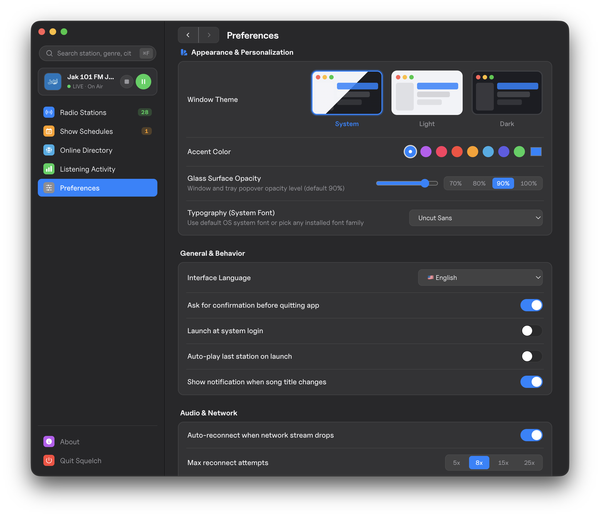
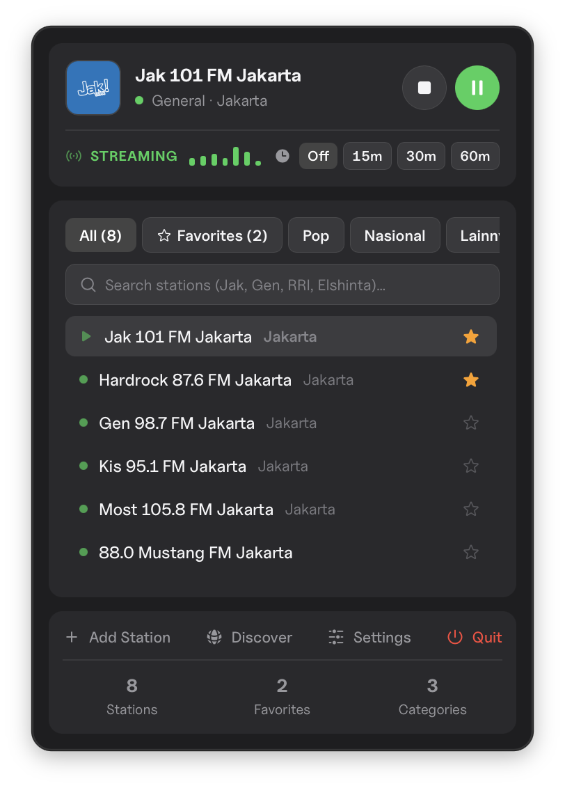
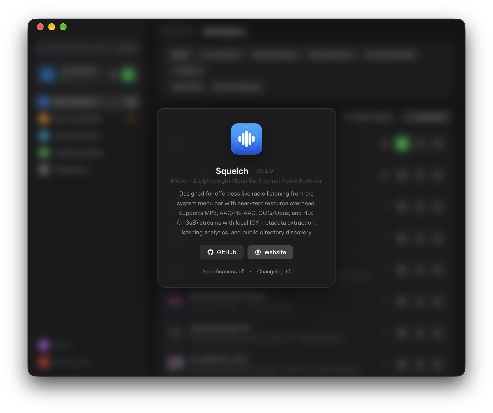

# Squelch

<p align="center">
  
</p>

<p align="center">
  <strong>Modern, lightweight, cross-platform menu bar internet radio player.</strong><br />
  Featuring a native macOS HUD Glass Bento interface, real-time ICY metadata extraction, broadcast show schedules with autoplay, and public directory discovery.
</p>

<p align="center">
  <a href="https://github.com/mrbvrz/squelch/blob/main/LICENSE">
    
  </a>
  <a href="https://github.com/mrbvrz/squelch/releases">
    
  </a>
  <a href="https://github.com/mrbvrz/squelch">
    
  </a>
</p>

---

## Interface Showcase

<p align="center">
  
</p>

<table align="center" style="border: none;">
  <tr>
    <td align="center" width="50%" style="border: none;">
      <strong>Menu Bar Tray Popover</strong><br /><br />
      
    </td>
    <td align="center" width="50%" style="border: none;">
      <strong>About Squelch</strong><br /><br />
      
    </td>
  </tr>
</table>

---

## Download

### macOS

Download the latest ready-to-run macOS package:

- 🍏 **[Download Squelch for macOS (.dmg)](https://github.com/mrbvrz/squelch/releases/download/v0.1.0/Squelch-0.1.0-arm64.dmg)**
- 📦 **[Download Squelch for macOS (.zip)](https://github.com/mrbvrz/squelch/releases/download/v0.1.0/Squelch-0.1.0-arm64-mac.zip)**
- 🚀 **[View All Release Assets](https://github.com/mrbvrz/squelch/releases/tag/v0.1.0)**

> [!NOTE]
> Open the `.dmg`, drag **Squelch.app** into your `/Applications` folder, and launch. The animated waveform radio icon appears directly in your system menu bar!

### Windows & Linux

> [!NOTE]
> **Windows (x64) and Linux (AppImage / .deb) support is Coming Soon!**  
> Squelch's domain core and audio engine are 100% OS-agnostic. Native Windows system tray and Linux MPRIS/AppIndicator adapters are currently in active staging.

---

## Support the Project

<p align="left">
  <a href="https://trakteer.id/mrbvrz" target="_blank">
    
  </a>
  &nbsp;&nbsp;
  <a href="https://www.buymeacoffee.com/mrbvrz" target="_blank">
    
  </a>
</p>

- 🇮🇩 **Trakteer**: [https://trakteer.id/mrbvrz](https://trakteer.id/mrbvrz)
- ☕ **Buy Me A Coffee**: [https://www.buymeacoffee.com/mrbvrz](https://www.buymeacoffee.com/mrbvrz)

---

## Key Highlights

- **macOS HUD Glass Bento Popover**
    - Native macOS HUD vibrancy window (`vibrancy: 'hud'`) with frosted Bento cards (`backdrop-filter: blur(24px) saturate(180%)`).
    - Pre-rendered 12-frame pure white Signed Distance Field (SDF) capsule waveform animation in the menu bar with zero CPU overhead.
    - Quick two-click playback, live audio signal spectrum bars, sleep timer presets (`15m`, `30m`, `60m`), and category filtering directly from the menu bar.
- **Show Schedules & Automated Autoplay**
    - Configure broadcast programs (e.g. _Sarapan Seru_ on Jak 101 FM, Monday–Friday 06:00–10:00).
    - Background scheduler engine with daily slot deduplication and native desktop notifications.
    - Optional _Autoplay_ switch to automatically tune in and stream when your show begins.
    - Live on-air pulsating badge (`🟢 On Air Now`) indicating active broadcasts.
- **Resilient Audio Engine & ICY Metadata Proxy**
    - Headless worker combining HTML5 Audio with `hls.js` supporting **MP3**, **AAC / HE-AAC**, **OGG / Opus**, and **HLS** (`.m3u8`).
    - Local in-process loopback proxy server (`127.0.0.1`) requesting `Icy-MetaData: 1`, parsing metadata blocks cleanly, and emitting real-time `StreamTitle` updates without audio glitching.
    - Exponential backoff reconnect with random jitter on network dropouts, plus auto pause/resume on system sleep/wake and audio device disconnection.
- **Unified Sidebar & Instant Keyboard Navigation**
    - Integrated mini player deck docked right below the search bar on the left sidebar.
    - Global `⌘F` (macOS) / `Ctrl+F` (Windows/Linux) search shortcut with key badge and auto-focus.
- **Open Public Radio Directory**
    - Search global stations powered by the `radio-browser.info` directory with automatic multi-mirror failover (`de1`, `fi1`, `at1`).
    - Country selection dropdown with emoji flags and inline audio stream previewing.
- **Listening Analytics**
    - Weekly, Monthly, and Yearly listening duration tracking with interactive bar charts.
- **Personalization & Custom Themes**
    - System, Light, and Dark window themes with visual preview cards.
    - 8 native macOS accent color palettes and adjustable frosted glass opacity.
    - Custom system font selector with automatic local font discovery.
    - Atomic JSON data backup and restore.

---

<a id="arsitektur--spesifikasi-teknis"></a>
<a id="architecture--technical-specifications"></a>

## Architecture & Technical Specifications

Squelch enforces strict domain boundaries: the core business logic is 100% operating-system and DOM agnostic.

```text
squelch/
├── src/
│   ├── core/                  # Pure OS-agnostic domain layer
│   │   ├── player/            # State machine, PlayerController, ICY proxy, stream tester
│   │   ├── schedules/         # Schedule models, repository, and background runner
│   │   ├── stations/          # Station repository, playlist parser, health checker
│   │   ├── discover/          # radio-browser.info client with mirror failover
│   │   ├── settings/          # User settings & runtime state models
│   │   ├── stats/             # Listening tracker & duration analytics
│   │   ├── storage/           # Atomic JSON store (.tmp + fsync + rename)
│   │   ├── events/            # Strongly-typed EventBus
│   │   └── diagnostics/       # Rotating file logger & diagnostics builder
│   ├── platform/              # OS-specific adapters (ITrayAdapter, ISystemIntegration)
│   │   ├── macos/             # macOS Tray, SDF waveform generator, power monitor
│   │   ├── windows/           # Windows system tray adapter
│   │   └── linux/             # Linux AppIndicator adapter
│   ├── main/                  # Electron main process, WindowManager, typed IPC handlers
│   └── ui/                    # React 18 + Tailwind CSS renderer views
│       ├── tray-popover/      # Bento Glass popover (tray.html)
│       ├── app/               # Full settings and management window (index.html)
│       ├── audio-worker/      # Headless audio transport worker (audio.html)
│       └── components/        # Shared Heroicons & UI primitives
├── docs/                      # Screenshots and architectural diagrams
├── resources/                 # 28 verified Indonesian radio stations seed
├── tests/                     # Unit & architectural boundary test suites
├── ARCHITECTURE.md            # Complete Technical Specifications & Architecture Document
└── CHANGELOG.md               # Version Release History
```

For detailed specifications on the ICY demuxing protocol, schedule runner algorithms, and storage guarantees, see **[ARCHITECTURE.md](ARCHITECTURE.md)**.

For the detailed version history and roadmap, see **[CHANGELOG.md](CHANGELOG.md)**.

---

## Getting Started

### Prerequisites

- **Node.js** `>= 20.x`
- **npm** `>= 10.x`
- **macOS** `12+` (Apple Silicon or Intel), **Windows 10/11**, or **Linux**

### Installation

```bash
# Clone the repository
git clone https://github.com/mrbvrz/squelch.git
cd squelch

# Install dependencies
npm install
```

### Build & Run

```bash
# Build TypeScript main process and Vite UI bundles
npm run build

# Launch Squelch
npm start

# Or run build and start in one command
npm run dev
```

---

## Development Scripts

| Command                | Description                                                          |
| :--------------------- | :------------------------------------------------------------------- |
| `npm run build`        | Compiles main process (`dist/`) and bundles Vite UI (`dist-ui/`).    |
| `npm start`            | Starts the compiled Electron application.                            |
| `npm run dev`          | Builds and launches Squelch in development mode.                     |
| `npm test`             | Runs unit and architectural boundary tests with Vitest.              |
| `npm run typecheck`    | Runs strict TypeScript verification across all configurations.       |
| `npm run format`       | Formats all code, JSON, and Markdown files with Prettier.            |
| `npm run format:check` | Checks code formatting without writing files.                        |
| `npm run verify:seed`  | Tests candidate radio streams and regenerates verified seed catalog. |
| `npm run dist:mac`     | Packages the macOS production application bundle.                    |

---

## Data Storage

All user configuration, schedules, and listening statistics are stored atomically in the operating system's standard application support folder:

- **macOS:** `~/Library/Application Support/Squelch/`
- **Windows:** `%APPDATA%\Squelch\`
- **Linux:** `~/.config/Squelch/`

Files persisted:

- `stations.json` — Station library and category groups
- `schedules.json` — Configured show schedules, alerts, and autoplay preferences
- `settings.json` — User preferences, theme, font, and shortcuts
- `stats.json` — Listening activity and duration history
- `state.json` — Runtime playback state (last active station)
- `logs/squelch.log` — Rotating log file (`<= 1 MB`)

---

## Author & License

- **Author:** [mrbvrz](https://mrbvrz.web.id)
- **Repository:** [https://github.com/mrbvrz/squelch](https://github.com/mrbvrz/squelch)
- **License:** [MIT License](LICENSE)
